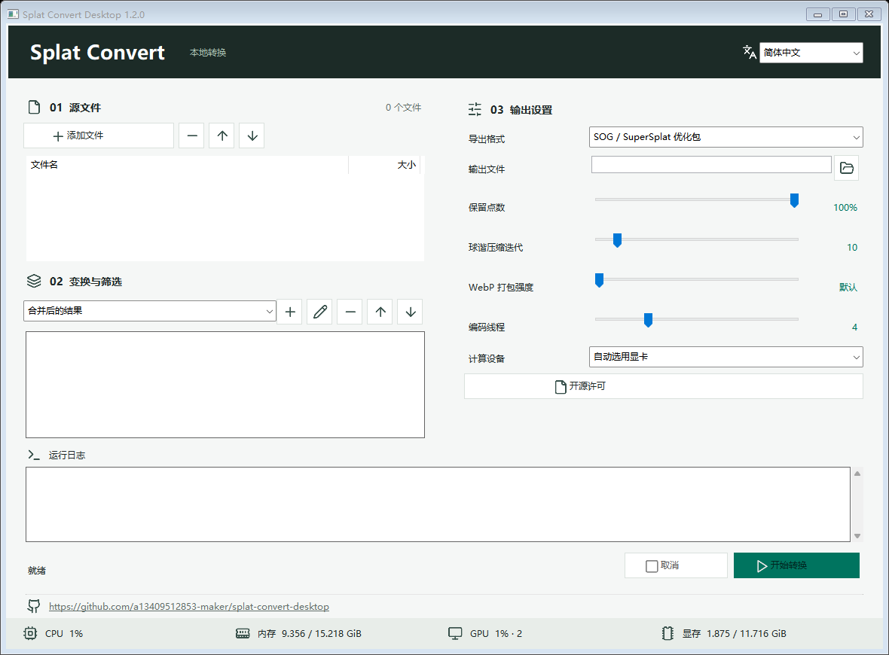

# Splat Convert Desktop

高斯泼溅（3DGS）大文件本地转换工具，绕开在线网页的文件体积与浏览器环境限制；免安装便携，现代图形界面轻松上手。支持 PLY 压缩为 SOG / SPZ / HTML 等多种格式，并内置一键去飞点、批量独立转换与国内直连引擎在线更新。

基于 [PlayCanvas Splat Transform](https://github.com/playcanvas/splat-transform) 的非官方 Windows / macOS 转换工具，所有 3D 文件均在本地处理，不上传云端。



当前 Windows 版本为 **2.0.0**（内置引擎 `@playcanvas/splat-transform` **3.12.0**）。本轮仅升级 Windows 原生端，macOS 端保持原有代码不变。

## 下载与运行

在 [Releases（发行版）](https://github.com/a13409512853-maker/splat-convert-desktop/releases) 下载适合自己电脑的文件。

| 系统 | 文件 | 使用方法 |
| --- | --- | --- |
| Windows 10 / 11，64 位 x64 | `Splat-Convert-Desktop-2.0.0-win-x64.exe` | 双击运行，无需安装 Node.js |
| macOS 13 或更高，Apple 芯片 | `Splat-Convert-Desktop-1.1.0-mac-arm64-adhoc.zip` | 解压后，将 `.app` 拖入“应用程序”并打开 |
| macOS 13 或更高，Intel 芯片 | `Splat-Convert-Desktop-1.1.0-mac-x64-adhoc.zip` | 解压后，将 `.app` 拖入“应用程序”并打开 |

Windows 版使用系统自带的 .NET Framework 4.8，适配 Windows 11 原生圆角与深浅色标题栏。

## v2.0.0 核心功能（Windows 端）

- **现代 Win11 三段式流水线界面**：按 **01 源文件 → 02 清洗与变换 → 03 输出与压缩** 从左到右推进，支持**深色 / 浅色双主题切换**并自动记忆偏好，全套采用 Lucide 明暗适配图标。
- **全量小白悬浮讲解**：鼠标悬停在任意设置项、格式、滑块或操作开关上，即弹出三段式讲解卡片（白话作用 + 调大/调小效果 + 新手建议）。
- **引擎剥离与国内直连多镜像更新**：`.exe` 内置 v3.12.0 引擎保证断网开箱即用；运行时解耦至 `%LocalAppData%\SplatConvertDesktop\engine\`，支持点击顶部引擎徽章从 **阿里云 npmmirror（国内首选）→ 腾讯云 NPM → 华为云 NPM → 官方 npmjs** 自动测速拉取新版，经 SHA-512 校验与 `--version` 自检后原子切换，随时可一键回滚内置版本。
- **批量独立转换 / 合并双模式**：支持一次拖入多个文件按原文件名批量输出到指定文件夹，也可切换为多文件合并输出。
- **同步 3.12.0 新特性**：
  - 输入：PLY（含压缩 PLY）、SOG、SPZ、KSPLAT、SPLAT、GLB、LCC、LCC2。
  - 输出：SOG、标准 PLY、压缩 PLY、**SPZ（Niantic 压缩格式）**、CSV 表格、HTML 内嵌查看器、体素 ZIP 碰撞数据包。
  - 清洗与变换：一键**去除空中飞点（`--filter-floaters`）**、**保留连通主体（`--filter-cluster`）**、自动清理无效点（NaN / Inf）、球谐阶数上限、平移、旋转、缩放、包围盒与球形裁剪。
  - **自适应抽稀（`--decimate-adaptive`）**：默认开启，在大幅减面时优先保护主体细节与天空，可随时切回均匀抽稀。
  - **Windows Vulkan 后端切换（`--gpu-backend vulkan`）**：设备设置中一键切换，绕过部分 Windows 显卡驱动在 D3D12 下的兼容问题。
  - **小白一键预设**：内置「极致瘦身 / 网页均衡 / 高质归档」三档预设。
- **实时百分比进度条与预估剩余时间（ETA）**：按字节块实时解析引擎进度输出，显示当前阶段、整体百分比、批量文件进度（`[i/N]`）、已用时与预计剩余时间。
- **七种界面语言**：简体中文、英语、日语、韩语、德语、法语、西班牙语；原始引擎日志保留原文，支持折叠日志抽屉。

### 0.5 秒高频资源监测与双色历史折线图

- Windows 端使用系统内存接口、处理器时间、DXGI 显卡信息和本地 GPU 性能计数器，窗口活跃时每 **0.5 秒**刷新一次 CPU、物理内存、GPU 与显存占用（最小化时降为 10 秒）。
- 鼠标悬停底部任意硬件指标，即弹出详细历史折线图悬浮窗：
  - 开始压缩时自动保留压缩前约 6 秒空闲基线，并在精确起点绘制「开始压缩」垂直虚线，空闲期与压缩期曲线以双色区分。
  - 压缩过程中 X 轴整体自适应拉伸，不会将空闲基线或压缩曲线移出画面左侧。
  - 压缩完成后曲线保持锁定，完整展示空闲期与整段压缩流程的负载与峰值，直至下一次压缩开始时才自动刷新。
- 启动转换前自动估算内存/显存开销并在余量不足时预警；提供常见失败诊断弹窗、诊断复制与日志定位。

## 本地构建

开发者需要 Node.js 22 或更高版本；普通使用者不需要安装它。

```sh
npm install
npm test
npm run test:conversion
```

Windows 构建：

```sh
npm run build:win
```

macOS 构建：

```sh
npm run build:mac:arm64
npm run build:mac:x64
```

运行结果位于 `dist/`（如 `dist/Splat-Convert-Desktop-2.0.0-win-x64.exe`）。下载缓存和临时构建内容在 `.cache/`，不应提交。构建脚本校验 Node.js 和 Electron 官方 SHA-256 清单；默认内置引擎为 `3.12.0`，Node.js 为 `22.23.2`，Electron 为 `45.3.0`。

## GitHub 自动构建与获取 EXE

仓库内已配置 `.github/workflows/build.yml`，提供两种自动产出 `Splat-Convert-Desktop-2.0.0-win-x64.exe` 的方式：

1. **推送版本标签自动生成草稿发行版（推荐）**：
   ```sh
   git add .
   git commit -m "feat(windows): upgrade to v2.0.0"
   git push origin main
   git tag v2.0.0
   git push origin v2.0.0
   ```
   等待 Actions 运行完成后，进入仓库 **Releases** 页面即可在草稿发行版中看到并下载 `Splat-Convert-Desktop-2.0.0-win-x64.exe`（编辑发布说明后点击 Publish release 即可正式发布）。
2. **手动触发构建并下载产物**：
   进入 GitHub 仓库顶部的 **Actions → Build desktop releases → Run workflow**，等待 `windows-2025` 任务变绿后，点进该次运行记录，在页面最底部的 **Artifacts** 区域下载 `desktop-win32-x64` 压缩包，解压即可得到 `.exe`。

只推送源码，不要把 `node_modules/`、`.cache/`、`dist/`、模型文件或本机凭据放进仓库。

## 源码结构

```text
windows/                 Windows 原生界面（方案 C 三段式流水线、主题、悬浮讲解、性能折线图、引擎多镜像更新与自测）
app/                     macOS Electron 界面、受限进程通信、多语言词典 locales.json
scripts/                 官方运行时下载校验、动态引擎打包、临时签名
tests/                   参数校验、提示持久化、真实引擎转换、苹果包结构检查
.github/workflows/       Windows、Apple 芯片、Intel 自动构建
```

## 隐私与本地数据

不提供遥测、账号登录或后台静默联网。本地转换全程离线；仅在用户主动点击「引擎更新」检查/拉取镜像或点击仓库链接时才会发起网络请求。

Windows 本地状态与解耦引擎存放于 `%LOCALAPPDATA%\SplatConvertDesktop\`（包含主题偏好 `theme.txt`、语言偏好 `language.txt`、一次性求赞标记与解耦引擎目录 `engine/`）。

## 许可证与致谢

本项目界面与构建代码采用 [MIT License](LICENSE)。上游引擎、Node.js、Electron、Dawn/WebGPU、WebP、SPZ 以及图标等组件分别遵循其自身许可证。

- [PlayCanvas Splat Transform](https://github.com/playcanvas/splat-transform)
- [SuperSplat Convert](https://superspl.at/convert)
- [Node.js](https://nodejs.org/)
- [Electron](https://www.electronjs.org/)
- [Lucide Icons](https://lucide.dev/)
- [apple-codesign](https://github.com/indygreg/apple-platform-rs)
