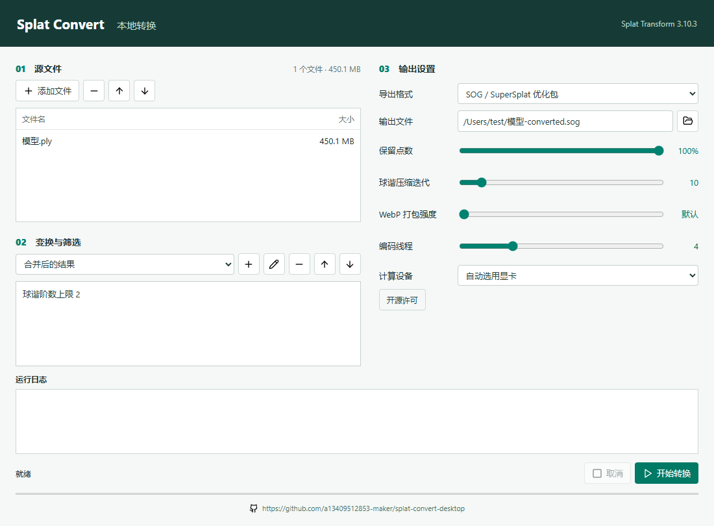

# Splat Convert Desktop

基于 [PlayCanvas Splat Transform](https://github.com/playcanvas/splat-transform) 的非官方 Windows / macOS 图形界面转换工具。文件在本地处理，不需要上传到转换网站。

项目地址：**https://github.com/a13409512853-maker/splat-convert-desktop**



## 下载与运行

在 [Releases（发行版）](https://github.com/a13409512853-maker/splat-convert-desktop/releases) 下载适合自己电脑的文件。

| 系统 | 文件 | 使用方法 |
| --- | --- | --- |
| Windows 10 / 11，64 位 x64 | `Splat-Convert-Desktop-1.1.0-win-x64.exe` | 双击运行，无需安装 Node.js |
| macOS 13 或更高，Apple 芯片 | `Splat-Convert-Desktop-1.1.0-mac-arm64-adhoc.zip` | 解压后，将 `.app` 拖入“应用程序”并打开 |
| macOS 13 或更高，Intel 芯片 | `Splat-Convert-Desktop-1.1.0-mac-x64-adhoc.zip` | 解压后，将 `.app` 拖入“应用程序”并打开 |

Windows 版使用系统自带的 .NET Framework 4.8。苹果芯片型号可在苹果菜单的“关于本机”中查看：显示 Apple M 系列就用 arm64，显示 Intel 就用 x64。

## 功能

- 输入：PLY（含压缩 PLY）、SOG、KSPLAT、SPLAT、SPZ。
- 输出：标准 PLY、压缩 PLY、SOG、CSV 表格、HTML 内嵌查看器、体素 ZIP 碰撞数据包。
- 多文件合并，可调整文件顺序。
- 对单个输入文件或合并结果分别添加有序操作：平移、旋转、缩放、无效点清理、球谐阶数上限、包围盒和球形范围筛选。
- 常用参数滑块：保留点数、球谐压缩迭代、WebP 无损打包强度、编码线程、体素边长和不透明度阈值。
- 本地日志、取消转换、输出覆盖确认。转换成功前不会替换已有目标文件。
- 两端主界面都有本项目仓库入口。首次成功导出后，仅提示一次为项目点 Star（赞）。关闭后也不会再次提示；不自动打开浏览器。

默认输出 SOG，保留 100% 的高斯点。球谐阶数上限在“变换与筛选”中添加。点数精简低于 100% 时，非标准 PLY 输出会先生成中间 PLY 再编码，需要额外磁盘空间。

## 本地构建

开发者需要 Node.js 22 或更高版本；普通使用者不需要安装它。先安装锁定的依赖并运行测试：

```sh
npm ci
npm test
npm run test:conversion
```

Windows 构建：

```sh
npm run build:win
```

macOS 构建：

```sh
npm run build:mac:arm64
npm run build:mac:x64
```

运行结果在 `dist/`。下载缓存和临时构建内容在 `.cache/`，不应提交。构建脚本校验 Node.js 和 Electron 官方 SHA-256 清单；转换引擎固定为 `3.10.3`，Node.js 为 `22.23.2`，Electron 为 `45.3.0`。

推荐在 macOS 上制作苹果正式发行包，脚本会使用系统 `codesign` 添加临时签名并验证应用。Windows 也能交叉打包苹果应用；交叉打包的 `-unsigned.zip` 不应直接发布，需要进一步签名。可运行：

```sh
node scripts/sign-mac.cjs dist/Splat-Convert-Desktop-1.1.0-mac-arm64-unsigned.zip
```

跨平台签名脚本会下载并校验开源 `apple-codesign 0.29.0` 的 Windows 版本。Windows 创建苹果内部符号链接时，需要系统开发者模式或管理员权限。也可以用环境变量 `RCODESIGN` 指向已安装的工具。脚本只添加临时签名，不需要或包含任何私钥。

## GitHub 自动构建

仓库内已有 `.github/workflows/build.yml`。在 GitHub 的 Actions（自动化操作）页面手动运行 `Build desktop releases`，会分别在 Windows、Apple 芯片 Mac 和 Intel Mac 上构建。每个平台先跑测试，再提供可下载的构建产物。

推送 `v` 开头的版本标签会自动创建一个草稿发行版，并附上三种程序文件；维护者检查后再发布。版本号位于 `package.json`、`app/package.json` 和 Windows 的程序集信息中，发布前应同步修改。

```sh
git tag v1.1.0
git push origin v1.1.0
```

只推送源码与锁文件，不要把 `node_modules/`、`.cache/`、`dist/`、模型文件或本机凭据放进仓库。EXE 和苹果 ZIP 应上传到发行版附件。

## 源码结构

```text
windows/                 Windows 原生界面、引擎调用、一次性提示与自测
app/                     macOS Electron 界面、受限进程通信、引擎调用
scripts/                 官方运行时下载校验、打包、临时签名
tests/                   参数校验、提示持久化、真实引擎转换、苹果包结构检查
.github/workflows/       Windows、Apple 芯片、Intel 自动构建
```

Windows 保留原有原生界面；macOS 使用 Electron 桌面窗口。两端调用官方引擎，不修改上游压缩算法。大文件在单独的引擎进程内处理，不会先读进图形界面。

## 隐私与提示记录

不提供遥测、登录或自动更新。转换不需要网络。只有点击仓库链接或提示中的“打开项目”，才会打开系统浏览器。

一次性求赞提示按当前操作系统用户记录，而非按 EXE 或版本号记录。Windows 标记位于 `%LOCALAPPDATA%/SplatConvertDesktop/star-prompt-shown-v1`；macOS 标记位于 Electron 返回的应用用户数据目录，通常是 `~/Library/Application Support/SplatConvertDesktop/star-prompt-shown-v1`。删除用户数据或换用户后会重新计数；标记不可写时跳过提示，不阻断转换。

## 局限性

- 此项目不是 PlayCanvas 或 SuperSplat 官方产品，不代表官方背书。
- 提供的苹果包使用临时签名（ad-hoc），没有 Apple Developer ID（开发者身份）签名或公证。Gatekeeper（系统安全检查）可能拦截首次打开。确认来源后，可按系统提供的“仍要打开”流程操作；不要全局关闭系统安全保护。Windows 包也未做商业代码签名，可能显示安全提示。
- 本次本地验收环境是 Windows。Windows 原生版已完成实际转换与界面测试；macOS 界面完成浏览器级交互测试，苹果包完成架构、权限、依赖、链接和签名资源检查，尚未完成 Mac 真机启动和 GPU 转换验收。苹果版本首次发布建议标记为预发布。
- 体素输出需要兼容的 GPU（图形处理器）和驱动。SOG / HTML 可改用 CPU（处理器）编码。普通网格 PLY 不一定包含高斯所需属性，不保证能作为高斯场景转换。
- 实际压缩率、耗时、内存和临时磁盘需求取决于场景。测试使用约 472 MB、200 万点的模拟文件，不代表所有真实大文件的表现。
- 仅覆盖转换网页提供的六种导出功能，没有把上游命令行的全部专业功能暴露为界面。

## 许可证与致谢

本项目界面与构建代码采用 [MIT License](LICENSE)。上游引擎、Node.js、Electron、Dawn/WebGPU、WebP、SPZ 以及图标等组件分别遵循其自身许可证。本仓库提供 `THIRD-PARTY-LICENSES.txt`，构建过程也会将依赖许可放入程序和发行包。

- [PlayCanvas Splat Transform](https://github.com/playcanvas/splat-transform)
- [SuperSplat Convert](https://superspl.at/convert)
- [Node.js](https://nodejs.org/)
- [Electron](https://www.electronjs.org/)
- [Lucide Icons](https://lucide.dev/)
- [apple-codesign](https://github.com/indygreg/apple-platform-rs)
