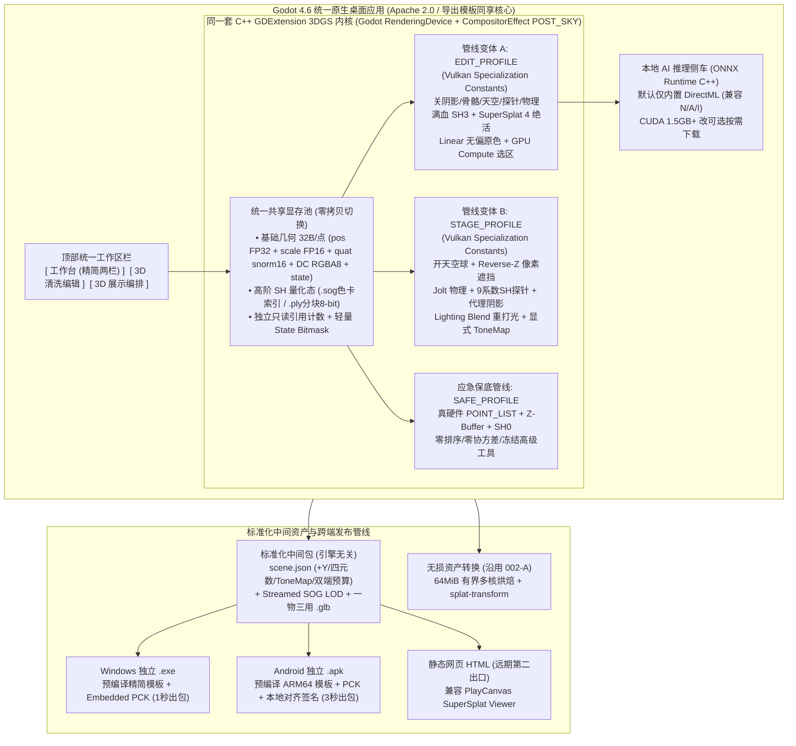

# Splat Convert Desktop V2.0 · 下一步开发计划、详细技术路线与未来展望（审阅版）

> **文档状态**：待用户技术审阅与开工授权（编制日期：2026-11-28）。
> **当前基线**：`V1.9`（`1.9.0`） 已整理为可独立备份上传的 GitHub 开源快照（见 `05_构建发布产物/GitHub_Release_V1.9/`）。
> **开源协议**：**Apache 2.0**（含完整 `NOTICE` 与 `THIRD_PARTY_LICENSES.md`，并随导出的 `.exe` / `.apk` 模板包附带）。
>
> **创作者归属保证（写入仓库首页、关于页与导出界面）**：
> 「你用本软件编辑、压缩或封装导出的任何 `.ply` / `.sog` / `.exe` / `.apk` 成品，其版权与商业分发权 100% 归你所有，本软件不主张任何权利，无需开源你的业务资产。」

---

## 一、战略目标：为什么要在此刻启动 V2.0 架构跃迁？

经过 `V1.1 → V1.9`（内部演进至 `3.2.3-rc14` 封口） 的完整打磨，我们已经把 3DGS 编辑交互范式（`+Y` 朝上、组合包裹体 CSG、Camera Raw 调色、SAM 2.1 语义分割、LaMa 平面补洞、智能测量、7 国语言）和 64 MiB 有界多核无损烘焙全部跑通，并通过 `002-B` 原生 Vulkan 旁路实测证实了原生显卡管线带来的 **5.6×–11× 帧率跃升**与 **4.7×–6.2× 内存骤降**。

同时，产品规划已从单纯的“格式转换 + 清洗工具”升级为**全链路 3DGS 生产与跨端交互发布平台**：
1. **阶段一 · 资产管理与 3D 清洗编辑**：极速导入千万级点云，保留完整 3 阶球谐反光、零拷贝非破坏性精修与无损导出；
2. **阶段二 · 3D 展示与交互编排**：在同一个软件中无缝切入编排模式，插入人物/小鸟/道具骨骼动画 `.glb`、配置转台/小鸟飞行/第一与第三人称物理漫游、预设相机轨迹轮播、文字/图片标注、天空球、热点点击切换至建筑内部高斯场景、以及基于高斯反推光照的混合受光与实时重打光；
3. **阶段三 · 零环境一键跨端交付**：既支持标准资产格式（`.sog / .spz / .ply / .html / .voxel.zip`），也支持**无需安装任何开发环境、数秒内一键封装独立 Windows `.exe` 与 Android `.apk` 单场景交互预览包**。

此时功能尚未失控膨胀，一次性转向 **Godot 4.6（MIT）+ 同一套 C++ `RenderingDevice` GDExtension** 统一底座，可彻底告别「WinForms + WebView2 WebGL2 + 独立 Vulkan 旁路」三套割裂体系与显存翻倍问题，一举解决未来 3 年的性能、跨端与功能上限。

---

## 二、V2.0 核心技术宪法与详细架构设计

### 2.1 总体分层架构（单进程、单显存、三工作区统一）



---

### 2.2 渲染管线与跨端安全设计（Windows + Android ARM64 同源）

1. **严格基于 Godot 原生 `RenderingDevice` + `CompositorEffect (POST_SKY)`**：
   - 不另起独立裸 `VkDevice` 硬做外部内存/信号量互操作，彻底规避 Windows/Android 多驱动兼容黑洞；
   - **挂点定为 `POST_SKY`**（而非 `POST_OPAQUE`）：确保不透明网格（人物/小鸟/道具）的 **Reverse-Z 深度缓冲** 与 **天空球底色** 均已绘制完成，3DGS 半透明边缘与天空球零黑边融合，且后续半透明玻璃、3D 文字 `Label3D` 与包裹体线框自然叠画在高斯之上；
   - **全局关闭 MSAA**（防止主深度图变成 `texture2DMS` 破坏采样并保护手机 Tile 带宽；必要时对 Mesh 启用轻量 FXAA/TAA）。
2. **同核双管线档位（Specialization Constants 编译期特化）**：
   - **`EDIT_PROFILE`（3D 编辑页）**：关闭不透明 Mesh 阴影贴图（CSM）、骨骼蒙皮、天空球、SH 探针采样、Lighting Blend 重打光与 Jolt 物理步进，主视口走 **Linear 无偏 ToneMap**，把 100% GPU 算力留给千万点编辑与原色直方图保真；
   - **`STAGE_PROFILE`（3D 编排页 & 导出预览器）**：开启天空球、Reverse-Z 深度遮挡、Jolt 物理、SH 探针、分区 `ReflectionProbe`、代理网格阴影与 `scene.json` 显式 ToneMapping（对 3DGS 做可控逆色调映射自然融入 HDR）；
   - **零拷贝秒切**：从编辑切到编排时底层 GPU 高斯缓冲原地不动，编排视锥剔除直接按 Bitmask 跳过已删点，**0 秒重载、显存绝不翻倍**。
3. **跨端安全 GPU 排序与剔除管线**（参考 `vk_gaussian_splatting` 通用光栅化思想 + `pocketsplat` 安卓避坑）：
   - **全流程纯 GPU Compute 驱动**：`视锥剔除 + Min Splat Size 剔除 + 流压缩 → 排序键生成 → GPU 基数排序 → vkCmdDrawIndirect`；
   - **排序键**：采用 **IEEE-754 32-bit 浮点深度（或径向距离）高 16 位**（天然对数尺度“近密远疏”，第一人称贴墙 0.3 米亚毫米级精度且不怕 2 公里外飞点拉爆精度，仅 3 行位运算）；
   - **无自旋可移植排序算法**：严禁依赖 Forward Progress 的 Onesweep，统一采用 **16-bit 2-pass（8-bit × 2）Reduce-then-Scan** 基数排序（`Histogram → Global Prefix Sum → Scatter`），同时支持 **`Radial` 径向排序**防原地转头闪烁；
   - **移动端 GLSL 编写硬红线**：严禁写死 Subgroup 宽度为 32（Adreno 64/128、Mali 16/32、NVIDIA 32）；Compute Workgroup 固定 `128` 或 `256`；禁用 `GL_EXT_shader_atomic_float` 与 64-bit 原子；单 Shader SSBO 绑定数 `≤ 8`；绝不依赖 Vulkan 1.4 / 硬件光追 / DLSS / Slang 私有扩展。

---

### 2.3 编辑态 vs 发布态彻底分家 + 正常编辑 vs 应急 Safe Mode

| 维度 | **正常编辑模式（默认）** | **应急性能模式（Safe Mode）** | **发布态（`.exe` / `.apk` / 网页）** |
| --- | --- | --- | --- |
| **LOD 策略** | **严禁有损 Streamed SOG LOD**（绝不漏删远处巨型飞点；亿级场景八叉树将巨型点强制置顶根节点常驻） | 全量原始点（零 LOD） | **`splat-transform` Streamed SOG 分块 LOD**，按显存预算流式加载（如 PC 800 万点 / 手机 150 万点） |
| **球谐（SH）策略** | **默认满血静态 `SH3`（量化压缩态）**：`.sog` 复用色卡 Palette（~70–140MB / 3500万点），`.ply` 流式分块 8-bit 量化；界面提供 **手动 `SH Bands (0–3)`** 开关 | **`SH0` 纯基础色**（完全不读高阶 SH 缓冲，显存读带宽直降 60%–80%） | 按用户在发布面板设定的 SH 阶数导出（如 PC 保留 SH2/3，手机压成 SH1/0 省 60%–75% 体积） |
| **渲染图元与排序** | `Splat` 椭圆 + **`Stochastic Alpha = Auto`**（拖动免排序、松手精排）+ **`Min Splat Size = 2`**（绝不隐巨型飞点）+ **`Radial` 排序** | **真硬件 `POINT_LIST` 中心点 + 硬件 Z-Buffer**（零排序、零协方差、1px 无 Overdraw，比 Splat 快 5–10×） | 静止精排 + 移动端可选动态 `Stochastic Alpha` + 深度混合遮挡 |
| **编辑数据结构** | **独立 `State` Bitmask + 引用共享**（选区/隐藏/删除/分离图层全零拷贝）；框选/套索/画笔/包裹体选点全部 **GPU Compute 化**（1–3 ms）+ 按需离屏 `R32UI` ID 拾取 | 冻结所有高级/AI/测量/调色工具，仅留最基础浏览、框选、软删除、撤销与保存 | 只读紧凑静态流式块 |
| **无损导出保障** | 磁盘原资产永远只读；无损 `.ply` 导出走磁盘高精源资产 + 稀疏配方流式多核烘焙（**0 二次量化劣化**） | 同左，随时可安全保存配方 | — |

#### 显存预算核算（以 3,487 万点《妖娆塞上》实拍大场景为例）
- 基础几何（`32 B/点`：`pos FP32×3` [防大场景百米坐标 FP16 台阶化] + `scale FP16×3` + `quat snorm16×3` + `DC RGBA8` + `state/objId`）：**`1.12 GB`**
- 高阶 SH（`.sog` 色卡索引 `2–4 B/点`）：**`0.07 – 0.14 GB`**（总显存 **`~1.3 GB`**！）
- 高阶 SH（`.ply` 分块 8-bit 量化 `48 B/点`）：**`1.67 GB`**（总显存 **`~2.8 GB`**，8–12 GB 显卡轻松跑满！）
- 排序辅助缓冲（仅可见点，经视锥 + Min Splat Size 剔除后通常为总点数的 20%–50%）：**`~0.15 – 0.35 GB`**
- **结论**：即便在 3,487 万点全量编辑态下，总显存可稳定压在 **1.6 ～ 3.2 GB**，较现行 WebView2（4.7 GB 内存 + 高显存）实现跨代跃升。

---

### 2.4 标准化中间资产协议（面向 `.exe` / `.apk` / 未来网页三端）

编排结果不与 Godot 私有 `.tscn` 场景树硬耦合，统一输出**开放、引擎无关的中间资产包**：

```text
project_bundle/
├── scene.json                     # 开放场景协议（schemaVersion: 1，全相对路径）
├── splats/
│   ├── exterior/lod-meta.json     # 室外建筑 Streamed SOG 分块 LOD
│   └── interior_hall/lod-meta.json# 室内展厅（通过热点 Portal 切换加载）
├── meshes/
│   ├── avatar_walk.glb            # 人物 PBR + 骨骼动画（一物三用）
│   ├── bird_fly.glb               # 小鸟飞行骨骼动画
│   └── proxy_building.glb         # 隐形物理碰撞体 + 阴影/重打光代理网格
├── lighting/
│   ├── sh_probes.bin              # 预烘焙 9 系数 L0-L2 SH 探针网格（64B/探针）
│   └── sky_env.ktx2               # 天空球与分区 ReflectionProbe 环境贴图
└── ui_assets/                     # 标注图片、图标、字体
```

- **`scene.json` 核心字段规范**：
  - `schemaVersion`、`coordSystem: "y-up-rh"`（右手 `+Y` 向上）、所有变换采用 **`position[3] + quaternion[4] + scale[3]`**；
  - `renderSettings`：显式 `toneMapping`（`linear / neutral / agx / aces`）、`exposure`、`budgets: { desktopMaxSplats: 8000000, mobileMaxSplats: 1500000 }`；
  - `modes`：启用的交互模式配置（`turntable` / `birdFlight` / `firstPerson` / `thirdPerson` / `cameraTracks`）；
  - `portals`：热点空间锚点、触发提示与目标子场景路径（支持点击建筑入口平滑淡入切换室内高斯模型）；
  - `annotations`：3D 空间文字/图片标注与可见距离；
  - `lighting`：SH 探针网格边界/分辨率、室内外 Zone 分区、主太阳光方向色温、高斯 `lightingBlend` 权重。

---

### 2.5 光照反推与实时重打光落地设计

1. **插入模型（小鸟、人物、道具）真实受光（零每帧重拍开销）**：
   - **漫反射（99.2% 能量还原）**：编排期在空间采样点自动离线渲染 6 面低分全景并投影成 **9 个 0～2 阶 SH 系数（FP16，64 B/探针）**；哪怕 2,048 个 3D 探针总共也只占 **128 KB**！飞行小鸟与行走人物每帧按位置做三线性插值（`< 0.01 ms`），平滑染上室外阳光、室内走廊、彩色灯墙的真实冷暖光；
   - **防穿墙漏光（Light Leaking）**：插值时叠加表面法线方向权重 + 室内/室外 Zone 隔离，杜绝薄墙两侧互相漏光；
   - **镜面反射与落地阴影**：搭配少量室外/室内分区 **`ReflectionProbe`** 负责金属/玻璃高光反射，并从全景最亮区自动反推 1 盏主太阳光配合 **`.glb` 代理网格** 投射真实软阴影；若用户手动拖动太阳角度，采用**分帧摊销更新**防卡顿。
2. **高斯本体实时重打光**：
   - 实时档采用 **近似表面法线（基于最扁协方差轴/深度法线）+ `Lighting Blend` 双通道权重混合 + 代理网格接/投阴影**，PC 与 Android 均可高帧率运行；
   - 远期高精离线档预留可选插件接口（如逆渲染 `GI-GS` / `GHPT` 离线烘焙 Albedo/法线/粗糙度通道）。

---

### 2.6 零 SDK 一键封装 `.exe` 与 `.apk` 原理

终端用户电脑**无需安装 Godot、Visual Studio、JDK 或 Android Studio**：
- **Windows 独立 `.exe`（~1 秒）**：软件内置预编译精简只读查看器模板 `viewer-template-win64.exe`（已集成 Godot 精简运行时 + C++ 3DGS 插件 + Apache 2.0 `NOTICE`）；导出时把中间包打成标准 `.pck` 直接拼接至模板尾部写入 `GDPC` 尾标（Embedded PCK），并按需替换用户自定义图标与标题。
- **Android 独立 `.apk`（~3 秒）**：软件内置预编译 `viewer-template-android-arm64.apk`（已集成 `arm64-v8a` `libgd_splat.so` + 触屏双摇杆/手势控制 + `NOTICE`）；导出时自动按手机档位生成 Streamed SOG LOD 并打包 `.pck` 注入 APK `assets/`，本地修改二进制 `AndroidManifest.xml`（应用名/包名/图标）、执行 4K ZIP 对齐与内置 **APK Signature Scheme v2/v3 纯本地签名**，直接产出手机可安装的 `.apk`。

---

### 2.7 开源协议合规落地方案（Day-1 同步建制）

- 仓库根目录建立三大合规文件：**`LICENSE`（Apache 2.0 原文）**、**`NOTICE`（本项目版权 + 全部上游 Apache 2.0 原始 `NOTICE` 汇总）**、**`THIRD_PARTY_LICENSES.md`**（按项目逐条列出仓库 URL、版权声明、协议名称与协议原文：Godot Engine、PlayCanvas Engine/SuperSplat/splat-transform/viewer、GDGS、pocketsplat、Niantic spz、NVIDIA vk_gaussian_splatting、ONNX Runtime、Meta SAM 2、LaMa 等）。
- 构建脚本自动校验：所有分发压缩包、Windows `.exe` 模板与 Android `.apk` 模板内均打包携带 `THIRD_PARTY_LICENSES.txt` 与 `NOTICE`，并在预览器「关于 / 开源致谢」页可直接查阅。

---

## 三、分阶段实施开发计划（Milestone 0 → 3）

### Milestone 0 · Godot 4.6 + C++ RD 3DGS 最小核心技术打样（POC）
> **目标**：先打穿最难的 4 个底层技术壁垒，验证全部硬指标达标后再铺开业务迁移，绝不盲目写几万行代码后才踩坑。

| 任务编号 | 核心内容 | 对照参考源码（`02_参考源码/`） | 验收硬指标 |
| :---: | --- | --- | --- |
| **M0.1** | 初始化 V2.0 Godot 4.6 仓库骨架（`LICENSE` / `NOTICE` / `THIRD_PARTY_LICENSES.md` + CMake/SCons Windows x64 `.dll` & Android ARM64 `.so` 构建脚本） | `godot-cpp`, `godot-cpp-template` | Win64 `.dll` 与 Android `.so` 编译 0 告警，Godot 4.6 成功加载插件 |
| **M0.2** | 实现 `CompositorEffect (POST_SKY)` + `RenderingDevice` 渲染核：32B 紧凑几何 + 量化 `SH0–3`（`.ply` 分块 8-bit + `.sog` 色卡）+ Float 高 16 位 2-pass Reduce-then-Scan 排序 + 视锥/Min Splat Size 剔除 + Indirect Draw + `Stochastic Alpha` + `Radial` 排序 + 真 `POINT_LIST` `Centers` | `godot-gaussian-splatting`, `engine`, `pocketsplat`, `vk_gaussian_splatting`, `spz` | 3,487 万点《妖娆塞上》全量 SH3 编辑显存 `≤ 3.5 GB`，拖动期（Stochastic Alpha）`≥ 60 FPS`、静止精排 `≥ 30 FPS`，`Centers+SH0` `≥ 100 FPS`；Vulkan Validation 0 Error |
| **M0.3** | 验证 `EDIT_PROFILE` vs `STAGE_PROFILE` 同核零拷贝切换：插入带骨骼 `.glb` 人物 + 天空球 + Reverse-Z 像素遮挡 + 9 系数 SH 探针受光 + 编辑态色准比对 | `godot-gaussian-splatting`, `supersplat` | 人物穿行高斯柱体前后像素级遮挡无穿帮；编辑态与原图色准 ΔE 达标；双模式切换显存增量 `≈ 0 MB` |
| **M0.4** | 验证零 SDK 导出最小 `.exe`（Embedded PCK）与 `.apk`（含 Streamed SOG LOD），在真实 Windows PC 与真机/模拟器安卓端跑通 | `splat-transform` | 导出耗时 `< 5s`，导出的 `.exe` 与 `.apk` 脱离开发环境独立启动流畅，内附 `NOTICE` |

---

### Milestone 1 · 精简两栏主界面 + 完整 3D 清洗编辑模块迁移
> **目标**：把你在其他对话设计好的新版两栏 Studio 主界面，以及 `V1.9` 经过验证的全套 3D 编辑工具无损迁移到 Godot 4.6，全面替代旧 V1.9 WebView2 编辑器。

- **M1.1 新版主界面与通用控件落地**：按新 UI 原型与 `design-tokens.json` 脚本自动生成 Godot `theme_dark.tres / theme_light.tres`；封装 `DragFloatField`、`ScrubSlider`、可复用色相环组件、延时 `BeginnerTipPopup`、0.5s 硬件遥测曲线 `_draw()`、`FileDialog.use_native_dialog`、7 国语言 `locales/*.json` 加载器。
- **M1.2 零拷贝非破坏性编辑会话与 GPU Compute 选区**：
  - 独立 `State` Bitmask + 引用共享（选区/隐藏/删除/多物体矩阵/复制分离全零拷贝）；
  - 框选/套索/椭圆/多边形/画笔（最大 `360px`）/包裹体选点全部 **GPU Compute 化**（3,500 万点 1–3 ms 响应）；
  - 按需离屏 `R32UI` ID 拾取服务于「仅选可见点」、吸管(`Y`)、透明度(`O`)、尺寸(`K`)、悬浮点(`F`)、连通主体（从旧主界面迁入！）。
- **M1.3 高级编辑子系统完整迁移**：
  - 组合包裹体（盒/球/圆柱 + 递归 CSG 布尔组 + 控点遮挡减淡 + 实时青蓝范围染色）；
  - Camera Raw 风格专业调色面板（仅统计模型像素直方图 + 8 段 HSL + 3D LUT + 分屏对比 + 松手单步撤销）；
  - 场景管理器（双击原位改名、多选合并/打组、`Ctrl+拖`复制）、自动折叠历史栈、`+Y` 自动/垂线/平面摆正、智能测量笔（比例尺 + 2.5D 堆体 4 视图）；
  - **原生 ONNX Runtime C++（DirectML 内置 / CUDA 按需下载）** 驱动 SAM 2.1 Tiny 2D/3D 语义分割与 LaMa L2 平面补洞（+ L0 纯色 / L1 几何）；
  - 独立 **应急性能保护模式（Safe Mode）** 锁定真硬件 `POINT_LIST + SH0`。
- **M1.4 资产兼容与离线烘焙对接**：100% 兼容打开历史 `v1–v4` 配方，复用 `64 MiB` 有界多核烘焙器与 `splat-transform` 转换引擎（并集成 Niantic `spz` C++ 原生高速读写）。

---

### Milestone 2 · 3D 展示编排工作区 + 光照融合 + 独立 `.exe` / `.apk` 封装发布
> **目标**：打通你的全链路差异化核心壁垒——从“清洗工具”进化为“3DGS 交互内容创作与跨端交付工具”。

- **M2.1 场景编排核心能力**：
  - 导入与摆放多套 3DGS 场景与 `.glb` 角色/小鸟/道具（支持动画片段选择与循环）；
  - 体素化/代理网格可视化一键生成 Jolt 物理碰撞体（支持半透明线框预览与手刷修补地面/空气墙）；
  - 交互模式编排器：转台参数、小鸟 `Path3D` 飞行路径与速度、第一/第三人称出生点/身高/视角限制、预设多段相机轨迹动画时间轴与自动轮播；
  - 3D 文字/图片标注气泡 + **热点 Portal 系统**（点击建筑入口平滑过渡加载室内 3DGS 模型）+ 天空球/HDRI 选择。
- **M2.2 光照反推与实时重打光**：
  - 一键空间布设并烘焙 **9 系数 L0–L2 SH 探针网格** + 室内/室外 Zone 标记与防漏光权重 + 分区 `ReflectionProbe`；
  - 自动反推主太阳光方向与色温 + 代理网格投/接软阴影 + 高斯本体近似法线 `Lighting Blend` 双通道实时重打光（拖动太阳分帧摊销更新）。
- **M2.3 跨端一键发布闭环**：
  - 输出标准化 `scene.json` + Streamed SOG LOD + `.glb` 中间包；
  - 集成 Windows `.exe`（Embedded PCK + 自定义图标标题）与 Android `.apk`（自动移动端 LOD 档位 + 本地 AXML/对齐/v2-v3 签名 + 触屏操控）零 SDK 一键导出，并自动内嵌 `NOTICE` 与 `THIRD_PARTY_LICENSES.txt`。

---

### Milestone 3 · 生态扩展与未来中长期展望（V2.1 – V3.0）

| 演进方向 | 核心能力规划 | 技术预留接口 |
| --- | --- | --- |
| **静态 HTML 网页第二出口（V2.1）** | 复用标准化 `scene.json` + Streamed SOG + `.glb`，一键导出兼容 PlayCanvas WebGPU/WebGL2 的纯静态网页包（支持微信/手机浏览器扫码直开） | `supersplat-viewer` 协议已在 M2 对齐 |
| **亿级超大规模点云编辑（V2.2）** | 八叉树空间分块 + 巨型点强制置顶根节点常驻显存 + 后台按视锥流式换页 + 全量原始索引 Bitmask 非破坏删除 | 底层引用共享与稀疏 Bitmask 已在 M1 预留 |
| **离线高精逆渲染重打光插件（V2.3）** | 可选下载扩展插件（基于 `GI-GS` / `GHPT` 等 Apache/MIT 方案），把静态高斯分解为 Albedo / 法线 / 粗糙度，实现任意旋转太阳的影院级重打光 | 插件化 AI 侧车与多链路下载器统一承接 |
| **4DGS 动态时序泼溅（V2.5+）** | 支持导入与剪辑动态 4D 高斯序列，在展示编排中作为动态人物/水流/火焰元素融入静态扫描场景 | `RenderingDevice` 双缓冲异步流式帧更新 |
| **创作者插件生态与模板库（V3.0）** | 开放 Godot GDExtension / 脚本扩展 API（自定义选区工具、自定义导出器、交互小部件模板如展馆语音导览/房产户型切换），结合 Apache 2.0 聚拢创作者社区 | `scene.json` 插件扩展字段 + 外部 `locales/` 热加载 |

---

## 四、核心风险与应对矩阵

| 潜在风险 | 影响 | 应对与兜底机制 |
| --- | :---: | --- |
| **Android 手机驱动碎片化（Mali / Adreno）** | 高 | M0 阶段即在真机/模拟器实测；严格执行 GLSL 移动端红线（无 Onesweep、无写死 Subgroup 32、Workgroup ≤ 256、Streamed SOG 控 150 万点预算） |
| **编辑态线性 HDR 色彩偏差** | 中 | `EDIT_PROFILE` 锁定精确 `sRGB→Linear` + 无偏 ToneMap，M0 阶段用标准色卡与原 `.ply` 逐像素比对 ΔE |
| **Godot 4.6 升级或 GDExtension ABI 波动** | 中 | 锁定特定 Godot 4.6.x 稳定版本与对应 `godot-cpp` Release Tag，C++ 内核与业务逻辑严格分层解耦 |
| **大型 `.ply` 直接编辑导入慢 / 显存超限** | 中 | 边流式读盘边多线程分块 8-bit 量化 SH（零 K-means 等待）；低显存设备提供手动 `SH Bands` 降档与 `Safe Mode`（`POINT_LIST + SH0`）保底 |
| **第三方开源合规疏漏** | 高 | 仓库根目录强制 CI 检查 `THIRD_PARTY_LICENSES.md` 与 `NOTICE` 同步；严禁接触 `03_历史归档与备份/` 中隔离的 GPLv3 或 NC 代码 |

---

## 五、审阅确认清单（请审阅后批复，确认即启动 V2.0 Milestone 0（重构完成并通过你验收后正式发布 V2.0））

在下一轮对话正式开工前，请你确认以下 5 项关键决策：

1. [ ] **Godot 版本锁定**：同意直接以 **Godot 4.6 稳定版**（内置 Jolt 物理默认启用）作为 V2.0 开发与导出模板基线（同意本机安装 Godot 4.6 与 Android NDK / SCons 交叉编译链用于编 `.so`）。
2. [ ] **渲染与双档位设计**：同意 `CompositorEffect` 挂点定在 **`POST_SKY`**、禁用 MSAA、Float 高 16 位 2-pass Reduce-then-Scan 排序、`EDIT_PROFILE` vs `STAGE_PROFILE` 同核零拷贝切换，以及正常编辑满血量化 `SH3` vs 应急 Safe Mode 硬件 `POINT_LIST + SH0`。
3. [ ] **开源协议与声明**：同意 V2.0 仓库采用 **`Apache 2.0`** + `NOTICE` 完整传递 + 文首「创作者归属保证」。
4. [ ] **推进节奏**：同意先跑完 **Milestone 0（最小核心验证 POC：3,487 万点渲染 + 遮挡 + SH 探针 + 最小 `.exe`/`.apk` 模板验证）** 并通过真机验收后，再全面启动 Milestone 1（接入你在其他对话设计好的新版两栏主 UI + 迁移完整编辑工具）。
5. [ ] **其他补充要求**：如有需要增删的功能、目标测试手机型号或偏好调整，请直接批注。
